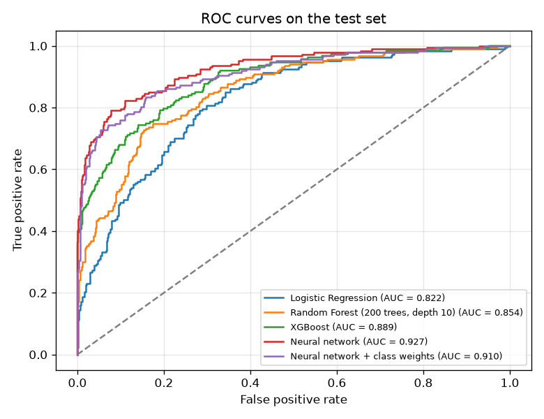
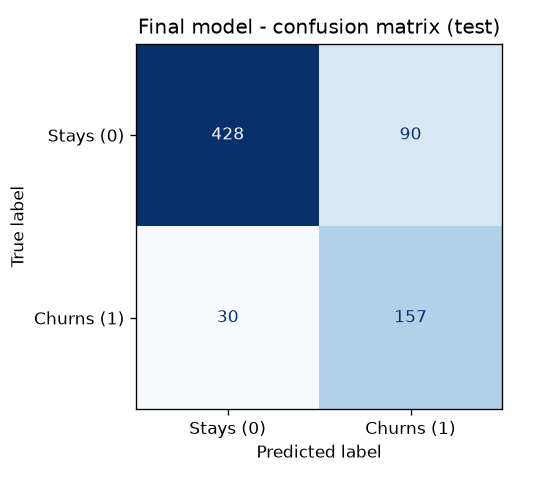
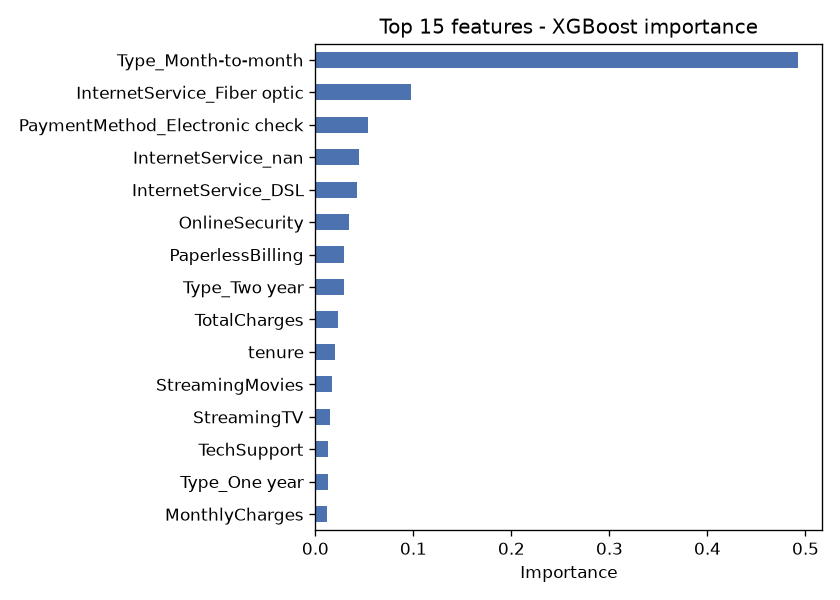
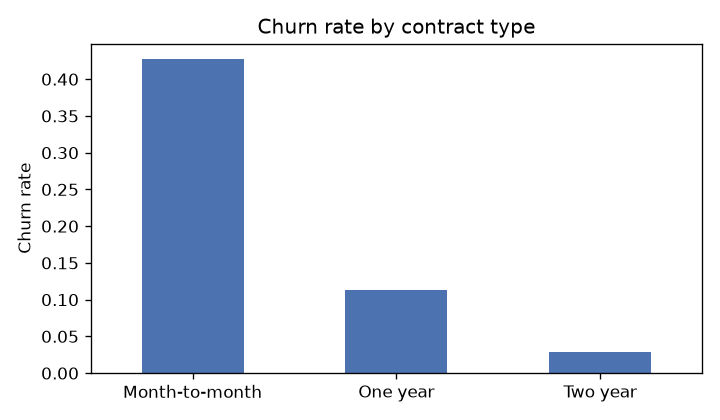

# Telecom Customer Churn Prediction

Predicting which customers of a telecom operator are about to cancel, so the marketing team can act before they leave. The final model detects **84% of churners** on held-out data with an **AUC-ROC of 0.91**.

*Built as the final project of the [TripleTen](https://tripleten.com/) Data Science program.*

## Business problem

**Interconnect**, a telecom operator, wants to reduce churn by identifying at-risk customers early and offering them promotions or special plans.

- **Task:** binary classification. `1` = the customer churned, `0` = the customer is still active.
- **Primary metric:** AUC-ROC.
- **Secondary metric:** recall on the churn class, because a missed churner is the costliest error.

## Dataset

Four CSV files joined on `customerID` into **7,043 customers** (26.5% churned):

| File | Rows | Content |
| :--- | ---: | :--- |
| `contract.csv` | 7,043 | Contract start/end dates, contract type, billing, payment method, charges |
| `personal.csv` | 7,043 | Gender, senior citizen, partner, dependents |
| `internet.csv` | 5,517 | Internet service type and add-ons (security, backup, streaming, etc.) |
| `phone.csv` | 6,361 | Multiple phone lines |

The target comes from `EndDate`: a date means the customer left, `"No"` means still active. Data snapshot: 2020-02-01.

## Approach

1. **Join and clean:** outer join of the four tables. Missing add-ons (no internet service) and missing `TotalCharges` (not billed yet) are filled with 0.
2. **Feature engineering:** `tenure` in days from `BeginDate` to the snapshot date, binary Yes/No mapping, one-hot encoding of contract type, payment method, internet service, and phone lines, and standard scaling of charges and tenure.
3. **Split:** stratified 80/10/10 into train (5,634), validation (704), and test (705).
4. **Models:** Logistic Regression, Random Forest (3 variants), XGBoost (grid search with an overfitting guard on the train–validation AUC gap), and a Keras neural network (16 → 8 → 1, early stopping).
5. **Class imbalance:** balanced class weights on the neural network.
6. **Selection:** best validation AUC-ROC. The test set is used only for the final check.

## Results

| Model | Validation AUC-ROC | Test AUC-ROC |
| :--- | :---: | :---: |
| Logistic Regression | 0.8029 | 0.8215 |
| Random Forest (200 trees, depth 10) | 0.8581 | 0.8537 |
| XGBoost (depth 3, 1200 trees, lr 0.009) | 0.8955 | 0.8888 |
| Neural network | 0.8992 | 0.9270 |
| **Neural network + class weights (final)** | **0.9118** | **0.9099** |

**Final model on the test set** (705 customers, threshold 0.5):

| Metric | Value |
| :--- | :---: |
| AUC-ROC | 0.9099 |
| Recall, churn class | 0.84 (157 of 187 churners detected) |
| Precision, churn class | 0.64 |
| Recall, active class | 0.83 |
| Accuracy | 0.83 |

The unweighted network has a higher test AUC (0.9270), but models are selected on validation data only, so it is reported here without being chosen after the fact.

<p align="center">
  
  
</p>

<p align="center">
  
  
</p>

## Business takeaways

- The model flags about **8 out of 10 customers who will churn**, giving marketing time to act.
- About 1 in 3 flagged customers would have stayed (precision 0.64). That is a reasonable trade-off when a retention offer costs much less than losing a customer. If offers are expensive, raise the decision threshold to cut false alarms.
- **Contract type is the strongest driver:** month-to-month customers churn at about 43%, versus 11% on one-year and 3% on two-year contracts. Fiber-optic internet and electronic-check payments follow.
- **Suggested actions:** target flagged month-to-month customers with incentives to move to longer contracts, and review the price and quality of the fiber-optic service.

## How to run

```bash
git clone https://github.com/jaimep0/churn_classification.git
cd churn_classification

python3.11 -m venv .venv
source .venv/bin/activate        # Windows: .venv\Scripts\activate
pip install -r requirements.txt

jupyter notebook notebooks/churn_prediction.ipynb
```

The notebook reads the data from `data/` with relative paths and saves the figures to `images/`. The original seed (`seed = 1234`) is kept, and TensorFlow runs with deterministic ops, so re-running with the pinned versions gives the same numbers. Results differ from the original course environment because of newer library versions (TensorFlow/Keras weight initialization, XGBoost).

## Repository structure

```
churn_classification/
├── data/                        # contract, personal, internet, phone CSVs
├── images/                      # figures used in this README
├── notebooks/
│   └── churn_prediction.ipynb   # full analysis, executed with outputs
├── requirements.txt
├── LICENSE
└── README.md
```

## Tech stack

Python · pandas · NumPy · scikit-learn · XGBoost · TensorFlow / Keras · Matplotlib · Jupyter
